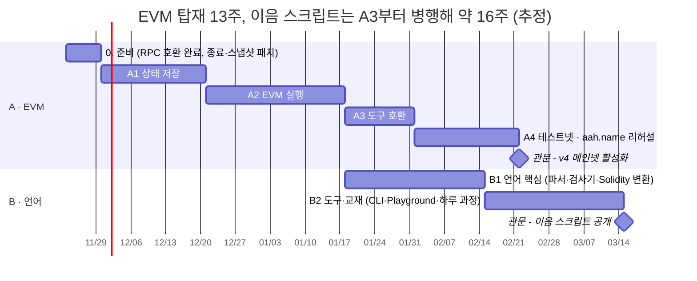

# IEUM Chain 스마트 계약 설계: EVM 탑재(A) → 이음 스크립트(B)

작성일 2026-11-24

## 개요

이음 체인(v1.0.8, Chain ID 21004)에 먼저 EVM을 탑재하고(A), 그 위에 하루 만에 배울 수 있는 "이음 스크립트"를 얹어 EVM 바이트코드로 컴파일한다(B). 실행기는 EVM 하나뿐이라, 이음 스크립트로 쓴 계약과 Solidity 계약이 같은 체인에서 서로 호출할 수 있다.

- **A의 목표:** aah.name이 geth에서 쓰는 밈코인(ERC-20), DEX, NFT, 게이트웨이를 코드 수정 없이 이음 체인으로 옮긴다. MetaMask, ethers, Remix, OpenZeppelin을 그대로 쓴다.
- **B의 목표:** 상속, 어셈블리, 저수준 호출을 뺀 작은 문법으로 토큰, NFT, 에스크로, 보상 계약을 누구나 쓰게 한다.
- **범위 밖:** 독자 VM, 다른 체인과의 브리지, 영지식 증명. 필요해지면 따로 설계한다.
- **선행 작업(완료, 2026-11-24):** RPC를 ethers v6로 파싱할 수 있게 고쳤다. 블록에 `difficulty`, `gasLimit`, `logsBloom` 등을 채우고, `miner`를 20바이트 주소로 바꾸고, keccak 해시로도 거래를 조회할 수 있게 했다. `eth_sendRawTransaction`은 keccak256(raw)을 돌려준다.

## 현재 상태

이음 체인은 송금만 실행하는 BFT 체인이다. 검증자 4명 중 3명이 서명하면 블록이 확정되고, 거래가 있을 때만 블록을 만든다. 상태는 잔액·nonce·스테이킹 맵이고, 원장은 `blocks.jsonl`과 월별 압축 백업, SQLite 상태 DB로 저장된다.

| aah.name 기능 | 필요한 체인 기능 | 지금 |
| --- | --- | --- |
| 코인 잔액·전송, QR 결제 | legacy 송금 | 가능 |
| 밈코인 생성 | 계약 배포(ERC-20) | 불가 |
| 토큰 조회 | `eth_call` | 항상 `0x` |
| DEX 스왑 | 계약 호출 | 불가 |
| NFT 경매·컬렉션 | ERC-721 | 불가 |
| 외부 체인 입금, 익스플로러 | `eth_getLogs`, 영수증 로그 | 항상 빈 목록 |
| MetaMask 기본 송금 | EIP-1559(type 2) 거래 | 거부 |

코드에는 이미 EVM을 넣을 자리가 있다. `rpc.rs`에 "Solidity EVM은 별도 실행 계층", `raw_transaction.rs`에 "EVM이 추가되기 전까지 거부"라는 주석이 있고, 프로토콜 버전을 높이로 켜는 `upgrades.json` 구조도 있다.

## A 구조: EVM 탑재

```mermaid
flowchart TB
  C[지갑 · aah.name 서버] --> R["JSON-RPC (eth_*)"]
  R --> B["멤풀 → BFT 합의<br/>4노드 중 3명 서명으로 확정"]
  subgraph X[실행기 - 확정 블록 단위]
    N["기존 규칙<br/>송금 · 이자 · 스테이킹"]
    E["EVM (revm)<br/>계약 배포 · 호출 · 가스"]
  end
  B --> X
  N --> S["상태 저장소<br/>잔액 · nonce · 코드 · 스토리지"]
  E --> S
  E --> L["영수증 · 로그<br/>eth_getLogs 색인"]
  S -- 상태 루트를 다음 서명에 포함 --> B
  R -. "eth_call · eth_getLogs (읽기, 블록 안 만듦)" .-> E
```



합의는 지금처럼 블록 순서만 정하고, 실행기가 확정된 블록을 차례로 적용한다. 받는 주소가 계약이거나 비어 있으면(배포) EVM으로, 그 밖의 거래와 시스템 이벤트는 기존 규칙으로 보낸다.

- **통합 지점:** `chain.rs`의 블록 적용 단계에 실행기를 두고, `raw_transaction.rs`가 calldata와 배포 거래를 받게 한다. 실행 라이브러리는 Rust로 쓴 revm이다.
- **상태:** 계정(잔액, nonce, 코드 해시), 코드, 스토리지를 기존 SQLite에 테이블로 추가한다. 블록에 `state_root`를 넣어 검증자 서명 대상에 포함한다.
- **가스와 수수료:** legacy `gasPrice` × 사용 가스, 블록 한도 30,000,000. 실패한 호출은 상태를 되돌리고 가스만 낸다.
- **영수증과 로그:** 블록별로 저장하고 `logsBloom`을 계산해 `eth_getLogs` 필터를 지원한다.
- **RPC:** `eth_call`, `eth_estimateGas`, `eth_getCode`, `eth_getStorageAt`을 실제 값으로 바꾼다. 지금은 고정값만 돌려준다.
- **결정성:** revm 버전을 고정하고, `block.timestamp`는 블록 시각, `prevrandao`는 0, `coinbase`는 생산자 검증자의 20바이트 주소로 정한다. 계약 안 난수는 지원하지 않는다.
- **활성화:** `upgrades.json`에 프로토콜 v4 높이를 적어 4노드가 같은 블록에서 동시에 EVM을 켠다. 그 전 블록은 기존 규칙으로 재검증한다.

## B 구조: 이음 스크립트

이음 스크립트는 새 VM이 아니라 Solidity로 바꾸어 주는 언어다. 첫 버전은 검증된 `solc` 컴파일러와 최적화기를 그대로 쓰고, 오류는 이음 스크립트 줄 번호로 알려 준다.

1. **파서:** `.ieum` 파일을 구문 트리로 읽는다.
2. **검사기:** 타입, 숨은 정수 오버플로, 금지 문법(반복 횟수가 정해지지 않은 루프, 외부 호출 후 상태 변경)을 여기서 먼저 걸러 한국어 오류를 낸다.
3. **변환기:** 검사를 통과한 트리를 Solidity 0.8 소스로 바꾼다. 재진입 방지 같은 안전장치는 자동으로 넣는다.
4. **solc:** 바이트코드와 ABI를 만든다. 생성된 Solidity도 함께 내주어 감사와 학습에 쓸 수 있게 한다.
5. **배포:** CLI 또는 Playground가 EIP-155 거래로 배포하고, 익스플로러에 소스를 검증 등록한다.

**도구**

- `ieum` CLI: `ieum new token`, `ieum build`, `ieum test`, `ieum deploy --rpc http://<노드>:8989`
- Playground: iem.aah.name에서 브라우저 안 solc-js로 컴파일하고 MetaMask로 배포
- 표준 라이브러리: `Token`, `Nft`, `Escrow`, `Reward` 템플릿. aah.name 밈코인 생성은 `Token` 템플릿을 쓴다.

## 이음 스크립트 문법 초안

아래 표와 타입 일곱 개(`return`, `if`/`else` 제외)가 문법의 전부다. 세미콜론, `function`, `uint256`, `msg.sender` 같은 잡음을 빼고, 하나는 하나의 Solidity 문법에 대응한다.

| 이음 스크립트 | 뜻 | 바뀌는 Solidity |
| --- | --- | --- |
| `contract 이름 { }` | 계약 하나 | `contract` |
| `이름: 타입` | 체인에 저장되는 값 | 상태 변수 |
| `init(...) { }` | 배포할 때 한 번 실행 | `constructor` |
| `public 이름(...) { }` | 누구나 부르는 기능 | `external` 함수 |
| `view 이름(...) -> 타입` | 읽기 전용, 수수료 없음 | `external view` |
| `only owner` | 주인만 부를 수 있음 | 제한자(modifier) |
| `payable` | IEUM을 함께 받음 | `payable` |
| `require(조건, "이유")` | 아니면 전체 취소 | `require` |
| `event` / `emit` | 기록 남기기(익스플로러, 알림) | `event` / `emit` |
| `pay(받는이, 금액)` | IEUM 보내기, 재진입 방지 포함 | `call{value:}` + 가드 |
| `for i in 0..10` | 횟수가 정해진 반복만 허용 | `for` |
| `use Token` | 표준 템플릿 가져오기 | OpenZeppelin 상속 |
| `sender`, `value`, `now` | 부른 사람, 보낸 금액, 블록 시각 | `msg.sender`, `msg.value`, `block.timestamp` |

타입은 `number`(음수 없는 정수), `int`, `bool`, `address`, `text`, `map[키 -> 값]`, `list[타입]`만 있다. 소수는 없다. 금액은 `1 ieum`, `0.5 ieum`처럼 쓰면 wei로 바뀐다.

**예제 1. 토큰을 직접 만들기**

```ieum
contract MemeCoin {
  balances: map[address -> number]
  total: number

  event Sent(from: address, to: address, amount: number)

  init(supply: number) {
    balances[sender] = supply
    total = supply
  }

  public send(to: address, amount: number) {
    require(balances[sender] >= amount, "잔액 부족")
    balances[sender] -= amount
    balances[to] += amount
    emit Sent(sender, to, amount)
  }

  view balanceOf(who: address) -> number {
    return balances[who]
  }
}
```

**예제 2. 템플릿으로 표준 토큰과 NFT 만들기**

```ieum
contract MemeCoin {
  use Token(name: "밈코인", symbol: "MEME", supply: 1000000)
}

contract HealthBadge {
  use Nft(name: "건강 배지", symbol: "BADGE")

  public award(to: address, badge: text) only owner {
    mint(to, badge)
  }
}
```

**예제 3. 에스크로 (물품 대금 맡아두기)**

```ieum
contract Escrow {
  buyer: address
  seller: address
  price: number
  paid: bool

  init(seller_: address, price_: number) {
    buyer = sender
    seller = seller_
    price = price_
  }

  public deposit() payable {
    require(sender == buyer, "구매자만 입금")
    require(value == price, "금액이 다름")
    paid = true
  }

  public confirm() {
    require(sender == buyer and paid, "확인할 수 없음")
    paid = false
    pay(seller, price)
  }
}
```

## 단계별 일정



전체 약 16주로 추정한다. 기간은 혼자 개발하며 Claude가 코드와 테스트를 돕는 조건의 예상이다. 각 단계는 아래 기준을 만족해야 끝난다.

| 단계 | 완료 기준 |
| --- | --- |
| 0. 준비 | ethers v6 파서 통과(완료), `shutdown-fix`·`snapshot-sign-nonfatal` 반영 후 재부팅 3회 강제 종료 0건 |
| A1 상태 저장 | 기존 블록 0~현재를 새 저장 구조로 재생했을 때 잔액이 현재 원장과 같음 |
| A2 EVM 실행 | OpenZeppelin ERC-20·ERC-721 테스트 통과, 같은 블록을 4노드가 실행한 state_root 일치 |
| A3 도구 호환 | Remix 배포, MetaMask 송금·토큰 추가, ethers `sendTransaction` 성공 |
| A4 테스트넷 | aah.name 계약과 잔액을 옮기는 리허설 2회 성공, 밈코인·DEX·NFT 화면 동작 |
| B1 언어 핵심 | 문법 초안의 예제 3개가 컴파일·배포되고, 오류가 한국어로 줄 번호와 함께 나옴 |
| B2 도구·교재 | 처음 쓰는 사람이 교재만 보고 하루 안에 토큰과 NFT를 배포함 |

## 위험과 대응, 열린 결정

| 위험 | 영향 | 대응 |
| --- | --- | --- |
| 노드마다 EVM 결과가 다름 | 블록 확정 실패, 체인 정지 | revm 버전 고정, 상태 루트를 블록에 넣어 2/3 서명 대상에 포함, 4노드 재실행 비교 테스트 |
| 무한 루프·대용량 저장 공격 | 블록 생성 지연 | 가스 상한, 저장 단위 수수료, 블록 가스 한도 30M |
| 기존 원장과 새 상태 형식 충돌 | 과거 블록 재검증 불가 | 활성 높이 이전 블록은 기존 규칙으로, 이후만 EVM으로 실행 |
| aah.name 이전 중 잔액 불일치 | 사용자 자산 손실 | geth 스냅샷 높이를 고정해 잔액·계약 저장소를 옮기고 리허설 2회 |
| 이음 스크립트 컴파일러 버그 | 계약 오작동 | 생성된 Solidity를 같이 공개, 템플릿은 OpenZeppelin 기반 |
| 노드 종료 시 강제 종료(SIGKILL) | 원장 손상 | `shutdown-fix.patch`를 A1 전에 반영 |

**열린 결정**

- [x] `eth_sendRawTransaction` 반환 해시 → 2026-11-24 결정: keccak256(raw)을 돌려준다. 조회는 IEUM 거래 ID와 keccak 해시를 모두 받고, 매니저는 `isPayoutHash`로 둘 다 허용하며 원장·익스플로러에는 IEUM 거래 ID를 계속 저장한다.
- [ ] EIP-1559(type 2) 거래를 A3에서 받을지, legacy만 유지할지
- [ ] 계약 배포 권한: 누구나 배포할지, 초기에는 허용 목록으로 제한할지
- [ ] 가스 수수료를 소각할지, 검증자에게 줄지
- [ ] 언어 이름과 키워드를 영어로 둘지, 한국어 별칭(`계약`, `공개`)도 허용할지
